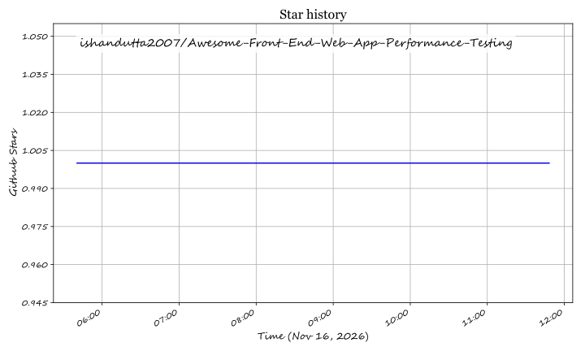

  

  
  
  
  
  
  

# ⚡ Awesome Front-End Web & App Performance Testing 🚀

> A curated, SEO-optimized directory of top-tier **Front-End Performance Testing Tools**, **Core Web Vitals Trackers**, **Synthetic Monitoring Engines**, and **Real-User Monitoring (RUM)** platforms. Whether you are aiming for a perfect 100 Google Lighthouse score, preventing performance regressions in CI/CD pipelines, or load testing web applications under peak traffic, this collection has you covered!

---

## 📑 Table of Contents
- [🌐 Sector Overview & Market Dynamics](#-sector-overview--market-dynamics)
- [🏢 SaaS & Hosted Monitoring Platforms](#-saas--hosted-monitoring-platforms)
- [💻 Open-Source GitHub Projects](#-open-source-github-projects)
- [🎯 Choosing the Right Tool](#-choosing-the-right-tool)
- [🤝 How to Contribute](#-how-to-contribute)
- [💖 Support](#-support)
- [📈 Star History](#-star-history)
- [⚠️ Disclaimer](#️-disclaimer)

---

## 🌐 Sector Overview & Market Dynamics

The global **Web Performance Monitoring** and **Digital Experience Monitoring (DEM)** market is estimated at **$6.7B to $7.5B** and is projected to surpass **$11B to $15.5B+ by 2030**, while the broader Application Performance Monitoring (APM) and observability landscape commands over **$10B+**. 

The sector displays a **moderately fragmented** market structure:
- **Enterprise Observability Giants**: Consolidated infrastructure titans (e.g., Dynatrace, Datadog, SolarWinds, Palo Alto Networks/Embrace, Cisco/Splunk) hold significant enterprise market share by bundling front-end tracking with full-stack telemetry and log management.
- **Vibrant Specialized Long-Tail**: Because web performance demands specialized browser-based synthetic audits, real-time Core Web Vitals instrumentation, waterfall profiling, and CI budget enforcement, focused SaaS point-solutions and open-source projects thrive independently. Engineering teams frequently adopt bottom-up developer tooling (like Lighthouse, sitespeed.io, and k6) before standardizing across enterprise environments.

---

## 🏢 SaaS & Hosted Monitoring Platforms

*Commercial platforms providing managed synthetic testing agents, global monitoring nodes, historical trend reporting, and real-user monitoring (RUM).*

| Product | Company Scale (Revenue / Valuation) | Pricing (Starting Tier) | Free Tier / Trial Limits | Description |
|---------|--------------------------------------|-------------------------|--------------------------|-------------|
| **[Pingdom](https://www.pingdom.com/)** | **~$700M+ ARR / Multi-billion parent** (SolarWinds; acquired for $103M) | **$18/month** (or $16.50/mo billed annually) for 10 uptime checks & 1 advanced check | **30-day free trial** with full synthetic & RUM feature access; no permanent free plan | 🌍 Global synthetic uptime, page speed monitoring, multi-step transaction checks, and root cause analysis. |
| **[BlazeMeter](https://www.blazemeter.com/)** | **~$500M–$750M ARR / Multi-billion parent** (Perforce Software, backed by Clearlake Capital & Francisco Partners) | **$149/month** (or $99/mo billed annually) for Basic tier (1,000 concurrent users) | **Free forever plan**: 25,000 requests/month, 1 team member; also offers a **14-day free trial** (100,000 requests) | ⚡ Enterprise load testing, API performance auditing, and continuous front-end performance validation platform. |
| **[SpeedCurve](https://www.speedcurve.com/)** | **~$24M ARR / $79.5M+ funding parent** (Embrace; acquired by Palo Alto Networks in 2026) | **$90/month** for Starter tier | **30-day free trial** (capped at 1,000 API requests/day, no credit card required); no permanent free plan | 📊 Continuous web performance monitoring unifying synthetic tests, real-user monitoring (LUX / RUM), and Core Web Vitals budgets. |
| **[GTmetrix](https://gtmetrix.com/)** | **~$330K ARR / PE-backed digital group** (group.one; acquired from Carbon60 in 2025) | **$5/month** (Micro PRO plan; $4.25/mo billed annually) | **Free forever plan**: 5 on-demand tests/month, 1 monitored daily slot, 1-week report retention | ⏱️ Popular web speed testing and synthetic performance monitoring across multiple global locations and device presets. |
| **[DebugBear](https://www.debugbear.com/)** | **~$330K ARR / Bootstrapped** (TinySeed-backed micro-SaaS; ~3 team members) | **$125/month** for Startup tier | **14-day free trial** (no credit card required); no permanent free plan (offers free one-off spot-check analyzers) | 🔍 Lighthouse-based performance and Core Web Vitals monitoring with synthetic tests across locations, devices, and CI/CD. |
| **[Calibre](https://calibreapp.com/)** | **Bootstrapped / Indie Micro-SaaS** (<$1M ARR estimated; self-funded) | **$75/month** for Starter tier (5,000 synthetic tests & 5,000 RUM sessions) | **15-day free trial** (no credit card required); no permanent free plan | 📉 Web performance monitoring unifying synthetic audits, Google CrUX dataset insights, and real-user data with performance budgets. |

---

## 💻 Open-Source GitHub Projects

*Free, self-hosted, and community-driven tools for front-end web audits, browser performance automation, load generation, and Core Web Vitals metrics collection. Sorted by GitHub Stars_Count in descending order.*

| Project | GitHub_Stars | License | Description |
|---------|--------------|---------|-------------|
| **[k6](https://github.com/grafana/k6)** |  | **AGPL-3.0** | 🚀 **Modern load testing tool for developers and testers.** Built in Go and JavaScript, k6 features a built-in browser module (`xk6-browser`) that runs Chromium-based browser tests alongside protocol-level load tests. Perfect for hybrid front-end and back-end stress analysis. |
| **[Lighthouse](https://github.com/GoogleChrome/lighthouse)** |  | **Apache-2.0** | 🏆 **The industry-standard open-source automated auditing tool.** Maintained by Google, Lighthouse audits Performance, Accessibility (a11y), Progressive Web Apps (PWA), SEO, and best practices. Runs in Chrome DevTools, CLI, Node module, or PageSpeed Insights. |
| **[Artillery](https://github.com/artilleryio/artillery)** |  | **MPL-2.0** | 💥 **Serverless, developer-first load and performance testing platform.** Supports testing HTTP APIs, GraphQL, WebSockets, and real-browser performance using Playwright. Easily distributed across AWS Lambda, Fargate, or Kubernetes with zero infrastructure overhead. |
| **[web-vitals](https://github.com/GoogleChrome/web-vitals)** |  | **Apache-2.0** | 📏 **Essential JavaScript library for capturing real-user Core Web Vitals.** Official Google library measuring Largest Contentful Paint (LCP), Interaction to Next Paint (INP), Cumulative Layout Shift (CLS), First Input Delay (FID), and Time to First Byte (TTFB) in production. |
| **[Lighthouse CI](https://github.com/GoogleChrome/lighthouse-ci)** |  | **Apache-2.0** | 🤖 **Automated CI/CD integration for Lighthouse audits.** Executes audits on every pull request, asserts performance budgets, and prevents performance regressions before deploying to production. Easily integrates with GitHub Actions, GitLab CI, and Jenkins. |
| **[sitespeed.io](https://github.com/sitespeedio/sitespeed.io)** |  | **MIT** | 🏎️ **Complete open-source web performance analysis suite.** Tests websites using real browsers (Chrome, Firefox), captures video recordings, calculates Speed Index, visual metrics, and pushes time-series performance data directly into Graphite, InfluxDB, or Grafana. |
| **[WebPageTest](https://github.com/WPO-Foundation/webpagetest)** |  | **Apache-2.0 / PolyForm** | 🔬 **The ultimate deep-dive waterfall and synthetic profiling platform.** Self-host your own test agents to inspect detailed resource waterfalls, trace events, connection diagrams, video frame-by-frame rendering, and real mobile device tests without per-test SaaS fees. |

---

## 🎯 Choosing the Right Tool

- **For Zero-Cost Canonical Google Audits**: Use **Lighthouse** via DevTools or CLI, and integrate **Lighthouse CI** into your GitHub Actions workflow for pull request quality gates.
- **For Production Real-User Monitoring (RUM)**: Embed **web-vitals** into your application bundle to pipe real Core Web Vitals (LCP, INP, CLS) to your analytics endpoint or Datadog/Grafana.
- **For Deep Waterfall & Self-Hosted Infrastructure**: Deploy **WebPageTest** private instances or **sitespeed.io** with Grafana dashboards for complete data sovereignty and zero third-party recurring fees.
- **For Combined Front-End & Load Testing**: Choose **k6** or **Artillery** to execute Chromium/Playwright-based browser user journeys while generating massive concurrent load.
- **For Turnkey Managed Dashboards & Alerting**: Turn to **SpeedCurve**, **DebugBear**, **Calibre**, or **GTmetrix** when you require hosted monitoring agents, team alerting, and automated executive reports without maintaining testing servers.

---

## 🤝 How to Contribute

Contributions are welcome and greatly appreciated! 

1. 🍴 **Fork the repo** to your personal GitHub account.
2. 🌿 **Create a new branch** (`git checkout -b feature/add-new-tool`).
3. 📝 **Add or edit entries** in `README.md` following the existing format (include name, official link, Stars_Badge, license, and factual description).
4. ✅ **Ensure accuracy**: Verify that URLs, pricing tiers, and open-source licenses are up to date.
5. 🚀 **Submit a Pull Request** with a concise description of your additions.

---

## 💖 Support

Thank you for exploring this awesome performance testing directory! If you find this repository helpful in optimizing your websites and applications:
- ⭐ **Star this repository** to help others discover it!
- 🍴 **Fork and share** with your fellow front-end engineers and DevOps teammates.
- ☕ **Buy me a coffee**: If you'd like to support the ongoing maintenance and curation of open developer resources, consider sponsoring via the [GitHub Sponsors Dashboard](https://github.com/sponsors/ishandutta2007).

---

## 📈 Star History

---

## ⚠️ Disclaimer

- This is an independent, **community-curated** educational directory — it is not an endorsement of any commercial product.
- Synthetic testing tools execute requests against target URLs; always rate-limit synthetic probes and avoid executing load tests against production endpoints without explicit authorization.
- Product pricing and free trial terms are subject to change by their respective vendors. Always check official documentation for the latest plan specifications.

---

  <b>Built with ⚡ for performance engineers, front-end developers, and web architects worldwide.</b>

## ⭐ Star History

<a href="https://star-history.com/#ishandutta2007/Awesome-Front-End-Web-App-Performance-Testing&Timeline" align="center">
  <picture>
    <source media="(prefers-color-scheme: dark)" srcset="assets/ishandutta2007_Awesome-Front-End-Web-App-Performance-Testing_growth.svg">
    
  </picture>
</a>
